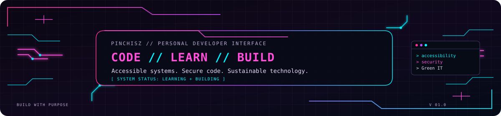

<!-- Cyberpunk palette: void purple #0B0713, neon pink #FF4FD8, hot pink #FF2E93, electric violet #B84DFF, cyber cyan #00F5FF, text lilac #EADCF8. -->

  <!-- Keep the original Astolfo GIF as the first visual on the profile. -->
  

   

  <!-- Commit assets/cyberpunk-header.svg alongside this README. -->
  

  <h1>Hi, I'm PinchiSZ 👋</h1>
  <h3>Code with purpose. Build for people. Design for a better future.</h3>

  

  

    
    
    
  

---

## `01 // About me`

I'm an **Information Systems student** building my foundations in software engineering, web development, APIs, databases and cloud technologies.

My goal is to grow as a **software developer** while gradually specialising in **cyber security**. I enjoy understanding how systems work, improving the way people interact with them, and learning how to make software more reliable, inclusive and secure.

- 💻 **Development:** JavaScript, HTML, CSS, Python, Java and Spring Boot.
- 🔐 **Long-term direction:** application security, secure coding, penetration testing and cloud security.
- ☁️ **Exploring:** cloud fundamentals, DevOps, automation and deployment workflows.
- ♿ **Accessibility & Design Justice:** technology should work for people with different abilities and circumstances.
- 🌱 **Green IT:** build thoughtfully, reduce unnecessary resource use and consider the environmental impact of software.

> My mission is to help solve real problems through code — creating technology that is secure, inclusive and sustainable.

---

## `02 // Tech stack`

### Hands-on tools and technologies

  

| Area | Current focus |
| --- | --- |
| **Front-end** | HTML, CSS, JavaScript, responsive layouts and accessible interactions |
| **Back-end** | Java, Spring Boot, REST APIs, validation and exception handling |
| **Data** | SQL, MySQL, JSON and browser `localStorage` |
| **Testing & quality** | Input validation, accessibility checks, debugging and software testing fundamentals |
| **Tools & workflows** | Git, GitHub, branches, pull requests, GitHub Actions and Docker fundamentals |
| **Visualisation** | Chart.js |

### `// Learning next`

`AWS` · `Azure` · `DevOps` · `Application Security` · `Penetration Testing` · `Ruby` · `Rust`

*This list reflects areas I'm exploring, not a claim of professional experience.*

---

## `03 // Featured projects`

### ♿ [Instituto TEIAS — Technology, Education, Inclusion and Sustainability](https://github.com/PinchiSZ/ong-terceiro-setor)
An academic NGO website built with **HTML, CSS and JavaScript**, focusing on accessibility, inclusive design, responsive layouts and Green IT. Current work includes accessibility improvements, colour-contrast checks, reduced-motion support and accessible interface components.

### ☕ [spring-ai-budgeting](https://github.com/PinchiSZ/spring-ai-budgeting)
A financial transaction management API built with **Java, Spring Boot, Spring AI, MySQL and Docker**, developed during a Java and AI bootcamp.

### 🧩 [spring-design-patterns-api](https://github.com/PinchiSZ/spring-design-patterns-api)
A REST API exploring **design patterns with Spring**, with work on validation, exception handling, documentation and tests.

### 🐍 [Python Hangman](https://github.com/PinchiSZ/python-hangman)
A terminal-based game focused on algorithmic thinking, modularisation and interactive gameplay.

  

---

## `04 // GitHub dashboard`

  
  

  

### `// Recent contribution activity`

  

### `// Contribution snake`

  <picture>
    <source media="(prefers-color-scheme: dark)" srcset="https://raw.githubusercontent.com/PinchiSZ/PinchiSZ/output/github-contribution-grid-snake-dark.svg" />
    <source media="(prefers-color-scheme: light)" srcset="https://raw.githubusercontent.com/PinchiSZ/PinchiSZ/output/github-contribution-grid-snake.svg" />
    
  </picture>

---

## `05 // Visitors from around the world`

  

  
<em>Thanks for stopping by — wherever in the world you're coding from!</em>

---

## `06 // What I care about`

| ♿ Accessibility | ⚖️ Design Justice | 🌱 Green IT | 🔐 Cyber security |
| --- | --- | --- | --- |
| Interfaces should be usable by as many people as possible. | People affected by technology should have a voice in its design. | Efficient, responsible software should consider its resource use and environmental impact. | Building responsibly means understanding how systems fail and how to make them more resilient. |

---

## `07 // Let's connect`

  
  
  

*“Technology only makes sense when it solves real problems — and I want to help build technology that is secure, inclusive and sustainable.”*

**`ACCESSIBILITY` · `SECURITY` · `GREEN IT` · `PEOPLE FIRST`**

