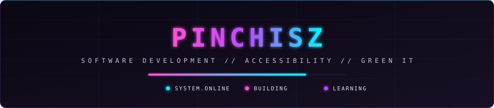

<!-- Cyberpunk palette: void purple #0B0713, neon pink #FF4FD8, hot pink #FF2E93, electric violet #B84DFF, cyber cyan #00F5FF, text lilac #EADCF8. -->

  <!-- Astolfo GIF -->
  

   

  <!-- Novo hero dashboard — antes do Hello -->
  

   

<h1></h1>

  

    
  

  

    SOFTWARE DEVELOPMENT // ACCESSIBILITY // GREEN IT
  

  

    
    
    
  

---

I'm an **Information Systems student** building my foundations in software engineering, web development, APIs, databases and cloud technologies.

My goal is to grow as a **software developer** while gradually specialising in **cyber security**. I enjoy understanding how systems work, improving the way people interact with them, and learning how to make software more reliable, inclusive and secure.

- 💻 **Development:** JavaScript, HTML, CSS, Python, Java and Spring Boot.
- 🔐 **Long-term direction:** application security, secure coding, penetration testing and cloud security.
- ☁️ **Exploring:** cloud fundamentals, DevOps, automation and deployment workflows.
- ♿ **Accessibility & Design Justice:** technology should work for people with different abilities and circumstances.
- 🌱 **Green IT:** build thoughtfully, reduce unnecessary resource use and consider the environmental impact of software.

> My mission is to help solve real problems through code — creating technology that is secure, inclusive and sustainable.

---

### Hands-on tools and technologies

  

| Area | Current focus |
| --- | --- |
| **Front-end** | HTML, CSS, JavaScript, responsive layouts and accessible interactions |
| **Back-end** | Java, Spring Boot, REST APIs, validation and exception handling |
| **Data** | SQL, MySQL, JSON and browser `localStorage` |
| **Testing & quality** | Input validation, accessibility checks, debugging and software testing fundamentals |
| **Tools & workflows** | Git, GitHub, branches, pull requests, GitHub Actions and Docker fundamentals |
| **Visualisation** | Chart.js |

`AWS` · `Azure` · `DevOps` · `Application Security` · `Penetration Testing` · `Ruby` · `Rust`

*This list reflects areas I'm exploring, not a claim of professional experience.*

---

### ♿ [Instituto TEIAS — Technology, Education, Inclusion and Sustainability](https://github.com/PinchiSZ/ong-terceiro-setor)
An academic NGO website built with **HTML, CSS and JavaScript**, focusing on accessibility, inclusive design, responsive layouts and Green IT. Current work includes accessibility improvements, colour-contrast checks, reduced-motion support and accessible interface components.

### ☕ [spring-ai-budgeting](https://github.com/PinchiSZ/spring-ai-budgeting)
A financial transaction management API built with **Java, Spring Boot, Spring AI, MySQL and Docker**, developed during a Java and AI bootcamp.

### 🧩 [spring-design-patterns-api](https://github.com/PinchiSZ/spring-design-patterns-api)
A REST API exploring **design patterns with Spring**, with work on validation, exception handling, documentation and tests.

---

  

---

  
// VISITORS BY COUNTRY — flags and counts update in real time

  <!-- Contador de bandeiras — tamanho natural, sem esticar -->
  

---

<!-- ✦ DIVISOR EXCLUSIVO PINCHISZ ✦ -->

  <h3>Let's build something meaningful — secure, inclusive and sustainable.</h3>

  

    
    
    
  

  Made with 💜, curiosity and a lot of <code>git commit -m "fix"</code>.

